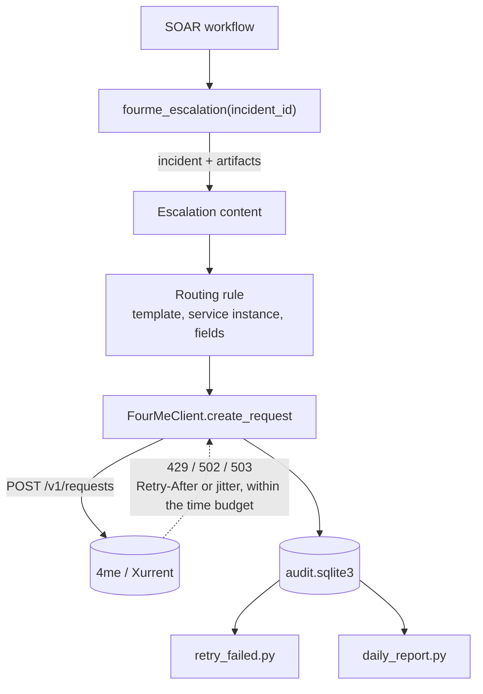

# ITSM 4me Integration

[](https://github.com/AtakanUk/itsm-4me-integration/actions/workflows/ci.yml)

[](LICENSE)

Escalates IBM QRadar SOAR incidents to the customer's 4me (Xurrent) service desk, with the reliability features you need once hundreds of escalations a day run into the 4me rate limit.

## Background

An MSSP SOC escalates every confirmed offense to the customer's IT team as a 4me request. The first version created requests synchronously from a SOAR function. Under load (bursts of offenses after a rule change) 4me answered with `429 Too Many Requests`, requests were lost and nobody noticed until the customer asked. This version fixes that:

- **Rate-limit aware retries**: `429`, `502` and `503` are retried. `Retry-After` is honoured in both its seconds and HTTP-date forms, with a cap. Otherwise the wait uses decorrelated jitter, so parallel workers spread out instead of retrying in lockstep. A total time budget (5 minutes by default) keeps the SOAR function from hanging.
- **No duplicate requests**: `504` is deliberately not retried. Request creation is not idempotent, and a gateway timeout may still have created the request.
- **Concurrency limit**: a process-wide semaphore caps parallel calls, because SOAR app functions run in worker threads.
- **Audit log**: every delivery is a row in SQLite with the payload, attempt count, last HTTP status, last error and timestamps. The database uses WAL mode with one connection per thread.
- **Manual recovery**: `retry_failed.py` re-sends stored payloads. Retries update the same audit row, so the history stays readable.
- **Visibility**: a daily HTML report lists totals plus every failed or pending delivery, and non-recoverable failures send an alert mail. When the rate-limit retries are exhausted, the alert has its own subject line.

## Components

| File | Purpose |
| --- | --- |
| `fourme_client.py` | 4me client: retry policy, `Retry-After` parsing, semaphore, audit and alert hooks |
| `fourme_audit.py` | SQLite audit log |
| `escalation.py` | Builds the escalation content from a SOAR incident and its artifacts: analyst description and suggestion, offense link, triggered rules, log sources (Custom Rule Engine excluded), offense source. Credential-leak incidents are built from their leak fields instead. |
| `template_router.py` | Picks the 4me template, service instance, impact and custom fields by incident name |
| `soar_function.py` | SOAR app function `fourme_escalation` (input: `incident_id`) that ties everything together |
| `retry_failed.py` | Audit viewer and manual retry CLI |
| `daily_report.py` | Daily report mail |
| `notify.py` | SMTP helper for alerts and reports |



## Configuration

Copy `.env.example` (environment of the resilient-circuits service and of the CLI tools) and `routing_rules.example.json` → `routing_rules.json`.

| Variable | Description |
| --- | --- |
| `FOURME_API_URL`, `FOURME_API_TOKEN`, `FOURME_ACCOUNT`, `FOURME_ACCOUNT_HEADER` | 4me API endpoint, personal access token and account |
| `FOURME_MAX_CONCURRENT` | Parallel request creations per process (default 2) |
| `FOURME_AUDIT_DB` | Audit database path |
| `FOURME_ROUTING_RULES` | Routing rules file |
| `QRADAR_CONSOLE` | Used to build the offense link in the request |
| `ESCALATION_RULE_ARTIFACT_TYPE`, `ESCALATION_LOG_SOURCE_ARTIFACT_TYPE` | SOAR artifact types that hold triggered rules and log sources |
| `ESCALATION_LEAK_INCIDENT_PATTERN` | Name pattern of credential-leak incidents |
| `SMTP_*`, `MAIL_FROM`, `ALERT_MAIL_TO`, `REPORT_MAIL_TO` | Mail delivery |

Routing rules are matched by case-insensitive substring, first match wins. A rule with `"contains": ""` acts as the default, and `"skip": true` ignores matching incidents:

```json
{"contains": "suspicious activity", "template": "<template id>", "service_instance_id": "<service instance id>",
 "impact": "low", "fields": ["qradar_id", "qradar_offense_url", "incident_analyst_description"]}
```

## Operations

```bash
python retry_failed.py --summary              # today's counts
python retry_failed.py --list-failed          # what failed and why
python retry_failed.py --show 42              # full record incl. payload
python retry_failed.py --id 42 --dry-run      # check before re-sending
python retry_failed.py --all-failed           # re-send everything that failed
python daily_report.py --skip-empty           # from cron, e.g. 23:55 UTC
```

## Deploying the SOAR function

Generate an app with `resilient-sdk codegen` that defines the function `fourme_escalation` with an `incident_id` input. Use `soar_function.py` as the function component, ship the other modules with the app, and call the function from the escalation workflow. Install the dependencies with `pip install -r requirements.txt` on the integration server.

## Tests

```bash
pip install pytest
pytest
```

The tests cover `Retry-After` parsing, backoff bounds, retry and budget behaviour, the "no retry on 504" rule, audit row reuse on manual retries, escalation building and routing.

## License

[MIT](LICENSE)
